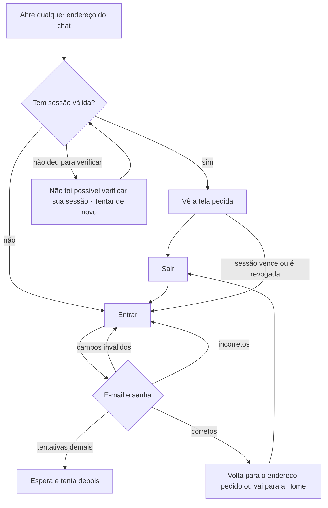

# PRD · F01 · Login e sessão

2026-11-09 · Luiz Carlos · Status: aprovado

## 1. Resumo executivo

- **Problema:** sem identificar quem está usando, o chat não sabe de quem é cada mensagem, quem
  pode ver um canal privado nem quem tem permissão de dados. Hoje não há como entrar no produto.
- **Solução proposta:** a pessoa entra com o e-mail e a senha da conta que a empresa criou para
  ela, continua logada em todas as abas do navegador por até 30 dias sem uso e sai quando quiser.
- **Critérios de sucesso:** esta funcionalidade não move sozinha nenhuma métrica do product brief
  (seção "Objetivos e métricas de sucesso"). Ela é pré-requisito de todas, porque todo pedido a
  um agente e toda Tarefa começam com uma pessoa logada. Ela cumpre o requisito não funcional
  "Sessão" do brief: nenhuma credencial acessível ao navegador, sessão revogável e válida para o
  navegador todo.

## 2. Experiência do usuário e funcionamento

### Personas

- **Pessoa do workspace:** tem uma conta criada pela empresa, por script e fora do produto (brief,
  "Fora de escopo"). Usa o chat no navegador do computador de trabalho, quase todo dia.
- **Administrador:** entra do mesmo jeito. A F01 não traz nada exclusivo para quem administra.

### Fluxo

### Histórias de usuário

1. Como pessoa do workspace, quero entrar com meu e-mail e minha senha para usar o chat com a
   minha identidade.
2. Como pessoa do workspace, quero saber o que errei ao preencher o login para corrigir e entrar.
3. Como pessoa do workspace, quero continuar logada em todas as abas e depois de fechar o
   navegador para não ter de entrar de novo a cada uso.
4. Como pessoa do workspace, quero cair na conversa que abri por um link depois de entrar para
   não ter de procurá-la de novo.
5. Como pessoa do workspace, quero sair do chat para que ninguém use a minha conta naquele
   navegador.
6. Como pessoa do workspace, quero ser levada à tela de entrar quando minha sessão acabar para
   entender por que não consigo mais usar o chat.
7. Como pessoa do workspace, quero que uma falha de conexão não me desconecte para não ter de
   entrar de novo por causa de uma queda da rede.

### Critérios de aceite

**História 1, entrar**

- A tela "Entrar" tem os campos E-mail e Senha e o botão "Entrar", como na seção Login do Figma
  do projeto, nos estados padrão, erro de validação, enviando e erro do servidor.
- Com o e-mail e a senha de uma conta existente, a pessoa entra no chat.
- O e-mail é aceito sem diferença entre maiúsculas e minúsculas e sem os espaços das pontas.
- Enquanto o envio está em andamento, o botão mostra que está enviando e não aceita um segundo
  envio.
- O fluxo inteiro funciona só pelo teclado: Tab percorre os campos e o botão, e Enter envia.
- A tela segue o design system do projeto e atinge 100 na nota de Acessibilidade do Lighthouse.

**História 2, erros ao entrar**

- E-mail vazio ou fora do formato mostra, abaixo do campo, "Informe um e-mail válido, como
  nome@empresa.com." Senha vazia mostra "Informe sua senha." Nenhum dos dois casos chega a enviar
  o login.
- E-mail inexistente ou senha errada mostram a mesma mensagem, "E-mail ou senha incorretos.
  Confira os dados e tente de novo.", sem revelar se o e-mail tem conta.
- Depois de 5 tentativas erradas em 15 minutos, as tentativas seguintes são recusadas por 15
  minutos, mesmo com a senha certa, e a tela avisa que houve tentativas demais e que a pessoa
  pode tentar de novo em alguns minutos. A mensagem não revela se o e-mail tem conta.
- Uma falha do servidor ou da rede no envio mostra um erro que pede para tentar de novo, diferente
  da mensagem de dados incorretos, e mantém o e-mail preenchido.

**História 3, continuar logada**

- Depois de entrar numa aba, as outras abas do mesmo navegador, abertas ou novas, já estão
  logadas, sem entrar de novo.
- Fechar e reabrir o navegador mantém a pessoa logada.
- A sessão vence depois de 30 dias sem uso. Cada uso renova o prazo, então quem usa o chat ao
  menos uma vez a cada 30 dias não precisa entrar de novo.
- Nenhum script da página consegue ler a credencial da sessão (brief, requisito não funcional
  "Sessão").
- Quem já está logado e abre "Entrar" vai direto para a Home.

**História 4, voltar para onde ia**

- Quem abre um endereço do chat sem sessão vai para "Entrar" e, depois de entrar, cai nesse
  endereço.
- Sem endereço pedido, ou com um endereço que não é do próprio chat, a pessoa cai na Home.

**História 5, sair**

- "Sair" fica disponível em qualquer tela do chat com a pessoa logada.
- Sair encerra a sessão daquele navegador e leva a pessoa para "Entrar".
- As outras abas do mesmo navegador vão para "Entrar" na próxima ação ou quando a conexão de
  tempo real é recusada, sem mostrar nem enviar mais nada em nome da pessoa.
- Sessões da mesma pessoa em outros navegadores e computadores continuam valendo.
- Depois de sair, voltar pelo histórico do navegador não mostra conteúdo do chat.

**História 6, sessão que acabou**

- Quando a sessão vence ou é revogada, a próxima ação ou conexão de tempo real em qualquer aba
  leva a pessoa para "Entrar". Depois de entrar de novo, ela volta para onde estava (história 4).

**História 7, falha ao verificar a sessão**

- Quando não dá para verificar a sessão por falha de rede ou do servidor, a pessoa vê "Não foi
  possível verificar sua sessão", com o botão "Tentar de novo", como na tela "Portas / Erro de
  sessão" do Figma, e não é mandada para "Entrar".
- "Tentar de novo" refaz a verificação e, se ela der certo, mostra a tela pedida.

### O que não é objetivo

- Criar conta, convidar pessoas ou redefinir senha pelo produto: as contas e as senhas são
  criadas por script, fora do produto, até a F15 (Cadastro e convite de pessoas).
- "Esqueci minha senha" e troca de senha pela própria pessoa.
- "Sair de todos os dispositivos", lista de sessões ativas e revogação de sessão por uma tela.
  No MVP, revogar uma sessão é uma operação fora do produto.
- Opção "lembrar de mim": a sessão sempre dura até 30 dias sem uso.
- Login corporativo (SSO), verificação em duas etapas e login por link mágico.
- Desativar ou bloquear a conta de uma pessoa.
- Conteúdo da Home: a F01 só leva a pessoa até ela. Canais, conversas e o resto entram da F02 em
  diante.
- Guardar o texto que a pessoa digitava quando a sessão acabou.

## 3. Requisitos do sistema de IA

Não se aplica: a F01 não envolve agentes.

## 4. Riscos de produto

| Risco | Mitigação |
| --- | --- |
| A pessoa esquece a senha e não há como recuperá-la pelo produto | Quem opera a instalação redefine a senha por script. Se isso virar gargalo, antecipar a recuperação de senha para a Fase 2, junto da F15 |
| Computador compartilhado: uma sessão de 30 dias deixa a conta aberta para o próximo usuário | O produto é para o computador de trabalho (brief, "Público-alvo"); "Sair" fica acessível em toda tela e encerra a sessão do navegador |
| Alguém tenta adivinhar senhas | Limite de 5 tentativas erradas em 15 minutos e mensagem que não revela se o e-mail tem conta |
| Um terceiro erra a senha de propósito com o e-mail de outra pessoa e a deixa sem entrar | O bloqueio dura só 15 minutos. Em que o limite se baseia (e-mail, rede ou os dois) fica para a spec |
| Uma queda de rede parece fim de sessão e faz a pessoa entrar de novo sem motivo | A falha ao verificar a sessão mostra "Não foi possível verificar sua sessão" com "Tentar de novo", sem mandar para "Entrar" |
| A sessão acaba no meio de uma ação e a pessoa perde o que estava fazendo | Com 30 dias renovados a cada uso, isso é raro. Depois de entrar de novo, ela volta para a mesma tela |
