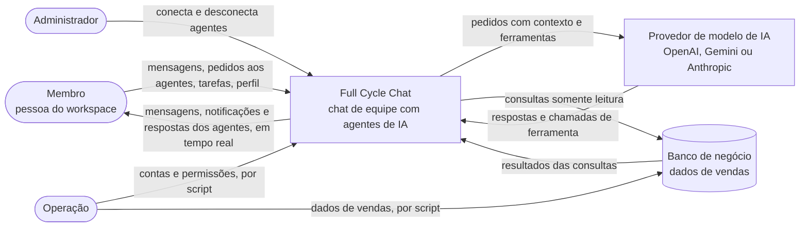
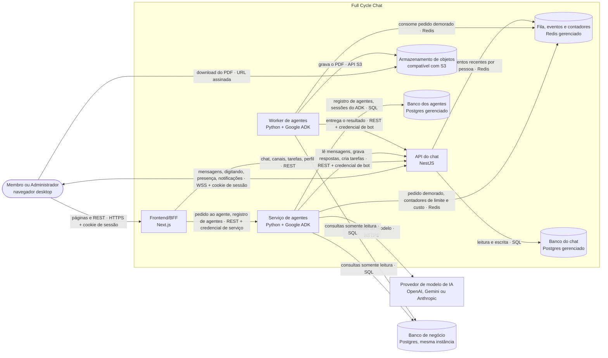

# HLD — Full Cycle Chat

2026-11-06 · Luiz Carlos · Status: rascunho · LLD: A definir

## 1. Contexto e objetivos

Full Cycle Chat é um chat de equipe web, no estilo Slack, para empresas pequenas e médias que
vendem para outras empresas: canais públicos e privados, conversas diretas, menções, tarefas e
notificações em tempo real. Sobre esse chat, agentes de IA entram como plugins e atendem pedidos
feitos na própria conversa. Este HLD cobre a Fase 1 (MVP).

Funcionalidades que mais pesam no desenho:

- **Chat**
  - Mensagens em tempo real em canais e DMs, com "digitando", edição e exclusão aparecendo para
    todos na hora, e recuperação do que se perdeu numa queda de conexão.
  - Canal privado visível e acessível só para quem foi convidado.
  - Contagem de não lidas e de menções por conversa.
  - Notificações de menção, DM e tarefa, na tela e do navegador, levando direto à mensagem.
  - Presença das pessoas (online, ausente).
- **Agentes**
  - Pedido a um agente por menção, com resposta pública na conversa, botões de resposta pronta e
    continuação sem nova menção.
  - Delegação que cria uma tarefa com responsável, notifica quem recebe e avisa quem delegou ao
    concluir ou reabrir.
  - Consulta a dados de vendas em linguagem natural, com permissão por pessoa, somente leitura e
    auditoria.
  - Relatório em PDF gerado em segundo plano, com o arquivo restrito a quem tem permissão.

**Objetivos de arquitetura**

- a. O chat continua funcionando quando o provedor do modelo de IA cai ou fica lento.
- b. Um agente novo entra ou sai do workspace sem mexer no núcleo do chat.
- c. Um pedido demorado a um agente não trava a conversa nem atrasa o chat das outras pessoas.
- d. O agente não consegue alterar dados de negócio, mesmo manipulado pelo que se escreve na
  conversa.
- e. Dado de negócio só chega a quem tem permissão, em qualquer saída (texto, PDF, notificação).
- f. Todo número que o agente entrega é rastreável até a consulta que o produziu.

**Não objetivos**

- Vários workspaces ou várias empresas na mesma instalação.
- Agente que escreve ou altera dados de negócio.
- Fontes de dados além do banco de vendas da empresa (planilhas, ERP, outras APIs).
- Agente que age sem ser chamado (lembretes, resumo automático).
- Cliente móvel, no navegador do celular ou em app nativo.
- Login corporativo (SSO) e chamadas de voz e vídeo.
- Alta disponibilidade: aceita-se ficar fora do ar quando a plataforma ou um componente cai.

### Stakeholders

| Papel | O que precisa da arquitetura | Onde encontra |
| --- | --- | --- |
| Dono do produto | O que cada objetivo custa e que riscos ficam | Seções 1, 11 e 12 |
| Desenvolvimento e agentes de código | As partes, como conversam e as decisões que não podem ser contrariadas | Seções 5, 6, 8 e 10, e o LLD |
| Operação | Onde roda, como implanta e o que observar | Seções 8 ("Observabilidade") e 9 |

## 2. Restrições

| Tipo | Restrição | Origem |
| --- | --- | --- |
| Tecnologia | Modelo de IA trocável por configuração entre OpenAI, Gemini e Anthropic, sem mudar código | Brief, RNF "Modelo de IA" |
| Plataforma | Web, só no navegador de desktop | Brief, "Escopo do MVP" e "Fora de escopo" |
| Segurança | Login por e-mail e senha; sessão revogável, válida para o navegador todo, sem credencial acessível ao navegador | Brief, "Escopo do MVP" item 1 e RNF "Sessão" |
| Operação | Contas e permissões criadas por script, fora do produto | Brief, "Fora de escopo" |
| Produto | Relatório de dados entregue como PDF para baixar | Brief, "Escopo do MVP" item 11 |
| Produto | Pedido demorado ao agente processado em segundo plano, com o resultado entregue depois na conversa | Brief, "Escopo do MVP" item 13 |
| Dados | Banco do chat e banco de negócio na mesma instância de banco de dados | Luiz Carlos, na entrevista do HLD |
| Prazo | Sem prazo de lançamento definido | Brief, RNF "Prazo" |
| Equipe | A definir | — |
| Orçamento | Teto mensal de infraestrutura a definir | — |

## 3. Requisitos de qualidade

| Prioridade | Atributo | Critério |
| --- | --- | --- |
| 1 | Confidencialidade | Nenhum dado de negócio, no texto ou no PDF, chega a quem não tem permissão de dados; os agentes não leem mensagens nem usuários do chat |
| 2 | Correção do agente | 0 número sem lastro entregue em resposta ou relatório; ≥ 98% de aprovação na avaliação completa |
| 3 | Integridade dos dados de negócio | Um texto na conversa com instruções ao agente não muda a consulta ao banco; nenhuma escrita gerada pelo agente altera dados de negócio |
| 4 | Desempenho do agente | Pedido comum com p95 ≤ 5 s |
| 5 | Custo do agente | ≤ US$ 0,01 por pedido; no máximo 10 pedidos por minuto por pessoa |
| 6 | Tempo real | Mensagem aparece para os outros em tempo a definir; quem cai e reconecta recebe o que perdeu sem recarregar a página |
| 7 | Auditabilidade | Toda consulta ao banco de negócio registrada (quem pediu, conversa, pergunta, consulta, desfecho), sem o resultado nem conteúdo de mensagens |
| 8 | Acessibilidade | Tudo funciona por teclado |

Num conflito, a linha de cima ganha: confidencialidade vem antes de correção.

**Hipóteses de dimensionamento:** A definir. Não há dado de contas, pessoas conectadas no pico,
mensagens por dia, pedidos aos agentes e PDFs por dia, nem do tamanho do banco de negócio; também
está a definir o que faria o desenho ser revisto.

## 4. Contexto do sistema

**Diagrama de contexto — Full Cycle Chat**

Legenda: forma arredondada = pessoa; retângulo = sistema; cilindro = banco de dados externo. O
banco de negócio é da empresa e fica na mesma instância do banco do chat (seção 2), mas o sistema
só o lê.

| Sistema externo | Para que | Como | Quem inicia |
| --- | --- | --- | --- |
| Provedor de modelo de IA (OpenAI, Gemini ou Anthropic) | Gerar as respostas dos agentes: resumo, delegação, consulta de dados | API HTTPS do provedor, escolhido por configuração | Full Cycle Chat |
| Banco de negócio | Fonte dos dados de vendas que os agentes consultam | SQL somente leitura ([ADR 0012](adr/0012-ferramenta-propria-sem-mcp.md)) | Full Cycle Chat |

A notificação do navegador só funciona com o chat aberto em alguma aba e sai pelo tempo real do
próprio sistema; não há serviço de push externo.

## 5. Arquitetura

Um monorepo com três aplicações implantadas separadamente numa plataforma gerenciada (PaaS): o
Frontend/BFF em Next.js, a API do chat em NestJS e os agentes em Python com Google ADK. A ideia
central é o chat não depender dos agentes: o BFF dispara o agente, e o agente devolve o resultado
à conversa como um bot, pela mesma API que as pessoas usam.

**Diagrama de contêineres — Full Cycle Chat**

Legenda: forma arredondada = pessoa; retângulo = contêiner que roda código ou sistema externo;
cilindro = armazenamento. Toda seta entre contêineres passa pela rede privada da PaaS; só o BFF e
o WebSocket da API do chat ficam expostos à internet. Banco do chat, banco dos agentes e banco de
negócio são três bancos na mesma instância de Postgres gerenciado.

| Contêiner | Responsabilidade | Tecnologia |
| --- | --- | --- |
| Frontend/BFF | Interface web e ponto de entrada REST do navegador; encaminha à API do chat e ao Serviço de agentes; reconhece menção ou resposta a um agente e dispara o pedido | Next.js |
| API do chat | Pessoas, sessões, canais, conversas, mensagens, tarefas, notificações e permissões; WebSocket de tempo real; entrega bloqueada de conteúdo de negócio; URL assinada do PDF; identificador de pedido | NestJS |
| Serviço de agentes | Registro dos agentes conectados; roda os agentes em pedidos comuns; limite de pedidos e teto de custo; monta e confere consultas; põe pedidos demorados na fila | Python + Google ADK |
| Worker de agentes | Executa pedidos demorados da fila: roda a consulta já conferida, confere o lastro, monta o PDF e o entrega na conversa; não chama o modelo | Python + Google ADK (mesmo projeto do Serviço de agentes, outro processo) |
| Redis | Fila de pedidos demorados, eventos recentes por pessoa para a reconexão, contadores de limite e custo | Redis gerenciado |
| Banco do chat | Dados do chat (seção 7) | Postgres gerenciado |
| Banco dos agentes | Registro de agentes e sessões do ADK | Postgres gerenciado, mesma instância |
| Armazenamento de objetos | PDFs gerados | Compatível com S3 |

A API do chat é REST e tem três consumidores: o BFF, que age em nome da pessoa com a sessão dela,
e o Serviço de agentes e o Worker, que agem como bots, cada um com credencial própria e permissões
limitadas. O WebSocket sai da mesma API. O contrato rota a rota fica no LLD.

## 6. Fluxos principais

### 6.1 Login e sessão

A pessoa envia e-mail e senha ao BFF, que os repassa à API do chat. A API confere a senha, com
limite de tentativas, cria a sessão no Banco do chat e devolve o identificador, que o BFF grava num
cookie httpOnly válido para os subdomínios do mesmo domínio (por exemplo `app.` e `api.`). O BFF
leva essa sessão em cada chamada à API do chat, e o WebSocket abre direto na API do chat com o
mesmo cookie; a API confere a sessão e a origem. Revogar é apagar a sessão no Banco do chat: a
próxima requisição ou conexão é recusada. Decisão: [ADR 0016](adr/0016-sessao-na-api-do-chat.md).

### 6.2 Mensagem em tempo real e recuperação após queda

O navegador envia a mensagem ao BFF, com um identificador gerado no cliente, e o BFF a grava na API
do chat por REST. A API grava a mensagem com o que ela causa (seção 7), publica o evento pelo
WebSocket para quem está na conversa e guarda o evento no Redis, por pessoa. Edição, exclusão,
"digitando" e notificações saem pelo mesmo caminho. Ao reconectar, o cliente informa o último
evento que confirmou e a API reenvia o que veio depois; uma queda mais longa que a retenção dos
eventos faz o cliente recarregar pelo histórico paginado. A API do chat roda com uma instância só,
então publica direto, sem nada entre instâncias.

### 6.3 Pedido comum a um agente

O BFF grava a mensagem com a menção pela API do chat, que emite um identificador de pedido. O BFF
reconhece que o agente mencionado está conectado, pelo registro do Serviço de agentes, e chama o
Serviço de agentes com o identificador, a mensagem, a identidade, as permissões e o fuso de quem
pediu, sem esperar a resposta. O Serviço de agentes confere o limite de pedidos e o teto de custo,
lê pela API do chat as mensagens de que precisa, chama o modelo e grava a resposta na conversa como
bot; a API a publica pelo WebSocket.

Quando o agente pergunta algo, a API do chat registra a pergunta pendente, e a próxima mensagem
dessa pessoa na conversa vai ao agente pelo mesmo caminho, sem nova menção. O clique num botão de
resposta pronta vira uma mensagem da pessoa na conversa. O estado do agente entre a pergunta e a
resposta fica no Banco dos agentes, nas sessões do ADK.

Se o modelo não responde ou dá erro, o agente grava na conversa que não conseguiu atender. Se nem
o Serviço de agentes recebe o pedido, o BFF mostra o erro a quem pediu. Nunca há resposta simulada.

### 6.4 Consulta a dados de negócio

O Serviço de agentes confere a permissão de dados recebida do BFF
([ADR 0015](adr/0015-permissoes-enviadas-pelo-bff.md)). Sem permissão, o agente responde na
conversa que a pessoa não tem acesso a dados de negócio, sem consultar o banco, e a tentativa é
auditada com o desfecho "sem permissão". Com permissão, o agente monta a consulta, que passa pela
conferência de somente leitura no código e roda com o usuário só leitura do Banco de negócio
([ADR 0013](adr/0013-somente-leitura-banco-e-codigo.md)). Antes de gravar, o agente confere que
cada número do texto aparece no resultado ([ADR 0014](adr/0014-lastro-antes-de-gravar.md)).

O agente grava a resposta marcada como "dados de negócio". Na entrega, no histórico e no
WebSocket, a API do chat manda o conteúdo só para quem tem permissão de dados; os outros membros
veem a mensagem bloqueada. O link do PDF segue a mesma regra (6.5).

O mecanismo que impede o conteúdo da conversa de influenciar a consulta e o lugar da auditoria
estão a definir (seção 12).

### 6.5 Relatório em PDF em segundo plano

O Serviço de agentes resolve com o modelo a consulta do relatório, confere-a, põe o pedido na fila
(Redis) e avisa na conversa que começou. O Worker consome o pedido, executa a consulta, confere o
lastro, monta o PDF, grava-o no armazenamento de objetos e o entrega na conversa pela API do chat,
numa mensagem marcada como "dados de negócio". No download, a API do chat confere a permissão de
quem clicou e gera uma URL assinada com validade curta. Se o Worker falha, o pedido volta à fila e
é tentado de novo algumas vezes; a entrega com o mesmo identificador de pedido acontece uma vez
só. Esgotadas as tentativas, o Worker grava na conversa que não conseguiu.

### 6.6 Delegação de tarefa

Quem pede menciona o agente e a pessoa que vai receber a tarefa. O agente interpreta o pedido e
cria a tarefa pela API do chat, com a pessoa mencionada como responsável e quem pediu como quem
delegou; a API do chat só aceita a ação ligada a um pedido real, em nome de quem fez aquele pedido
([ADR 0011](adr/0011-identificador-de-pedido.md)). Avisos e notificações são regra do chat, e não
do agente: a API do chat notifica o responsável pelo WebSocket e põe a tarefa em Atividade →
Tarefas. Quando o responsável conclui ou reabre a tarefa (Navegador → BFF → API do chat), a API do
chat avisa quem delegou.

## 7. Dados

| Onde | O que guarda |
| --- | --- |
| Banco do chat (Postgres) | Pessoas, com perfil, papel de administrador e permissão de dados; sessões; canais e membros; conversas diretas; mensagens, com autor pessoa ou bot, citação e a marca "dados de negócio"; menções; última leitura por pessoa e conversa (de onde saem as não lidas); notificações; tarefas; pedidos aos agentes, com o identificador; perguntas pendentes; referência ao PDF de uma mensagem |
| Banco dos agentes (Postgres, mesma instância) | Registro de agentes conectados; sessões do ADK |
| Banco de negócio (Postgres, mesma instância) | Dados de vendas (pedidos, clientes, vendedores), carregados por script; o sistema só lê |
| Redis | Fila de pedidos demorados; eventos recentes por pessoa para a reconexão; contadores de limite de pedidos e de custo |
| Armazenamento de objetos | PDFs gerados |

Regras que pesam no desenho:

- Gravar uma mensagem e gerar as menções, as notificações e a contagem de não lidas que ela causa
  é uma transação só no Banco do chat; o mesmo vale para criar, concluir e reabrir uma tarefa com a
  notificação dela. Só depois de confirmada a transação o evento sai pelo WebSocket.
- Apagar uma mensagem apaga o conteúdo de vez; fica só a marca "mensagem apagada".
- Os agentes não acessam o Banco do chat: as mensagens de que precisam chegam pela API do chat.
- A retenção dos PDFs no armazenamento e a da auditoria das consultas estão a definir.
- Os eventos de reconexão no Redis são temporários; perdê-los só obriga o cliente a recarregar pelo
  histórico.

## 8. Conceitos transversais

### Segurança e privacidade

- Autenticação: a API do chat confere a senha, guardada só como hash, com limite de tentativas, e
  cria a sessão no Banco do chat; cookie httpOnly válido para os subdomínios; o WebSocket confere a
  origem (6.1).
- Autorização no chat: a API do chat confere, no REST e no WebSocket, a participação em canal
  privado e conversa direta.
- Serviço a serviço: o BFF chama o Serviço de agentes com credencial de serviço; os bots usam
  credencial própria e só agem dentro de um pedido real (6.6).
- Administração de agentes: só administradores conectam e desconectam; o Serviço de agentes
  confere o papel enviado pelo BFF.
- Dados de negócio: somente leitura no banco e no código, lastro de cada número, conteúdo bloqueado
  na entrega e URL assinada com validade curta (6.4 e 6.5).
- Rede: HTTPS e WSS entre o navegador e o sistema; os contêineres conversam pela rede privada da
  PaaS, e só o BFF e o WebSocket da API do chat ficam expostos.
- O impacto da LGPD no desenho está a definir (seção 12).

### Observabilidade

Todos os contêineres gravam logs estruturados, sem conteúdo de mensagens e sem resultado de
consultas. O identificador de pedido (6.6) atravessa o BFF, o Serviço de agentes, o Worker e a API
do chat e liga os logs de um mesmo pedido. Tempo de resposta, custo por pedido, respostas barradas
pelo lastro e falhas do modelo são campos desses logs, lidos nos logs e métricas da própria PaaS.
As métricas de produto (uso do agente, tarefas delegadas concluídas) saem do Banco do chat. Os
alertas, e quem é avisado, estão a definir.

### Erros, novas tentativas e idempotência

- O chat não depende dos agentes: se o Serviço de agentes ou o modelo falha, a mensagem já está
  gravada e quem pediu vê o erro ou o "não consegui" (6.3). Nunca há resposta simulada.
- Não há troca automática de provedor do modelo: só roda o modelo configurado.
- O envio de mensagem leva um identificador gerado no cliente; reenviar após falha de rede não
  duplica a mensagem.
- Cada ação de bot (resposta, tarefa, entrega do PDF) vale uma vez por identificador de pedido.
- O Worker tenta de novo um número limitado de vezes e, esgotadas as tentativas, avisa que não
  conseguiu (6.5).
- Na queda do WebSocket, a reconexão reenvia os eventos desde o último confirmado (6.2).
- Com o Redis fora, os pedidos aos agentes são recusados até ele voltar, para o custo não escapar
  do teto.

### Configuração e segredos

A configuração e os segredos vêm das variáveis e segredos da PaaS, por ambiente; nenhum segredo
fica no repositório. Cada contêiner recebe só os seus: a chave do modelo vai para o Serviço de
agentes; o usuário só leitura do Banco de negócio, para o Serviço de agentes e o Worker; a
credencial do armazenamento, para a API do chat (que assina a URL) e para o Worker (que grava o
PDF); as credenciais de bot, para o Serviço de agentes e o Worker. O provedor e o modelo de IA são
configuração (seção 2).

### Idioma e fuso

Interface e respostas em português do Brasil. O "hoje" de um resumo segue o fuso de quem pediu, que
o BFF envia junto com a identidade (6.3).

### Acessibilidade

Tudo funciona por teclado. É regra do Frontend; o desenho fica no LLD.

## 9. Implantação e ambientes

| Ambiente | Para que serve | Onde roda |
| --- | --- | --- |
| Local | Desenvolvimento | Contêineres na máquina de quem desenvolve |
| Produção | Uso real | PaaS a definir |

**Produção.** Cada aplicação roda como serviço da PaaS: Frontend/BFF, API do chat, Serviço de
agentes e Worker, com Postgres e Redis gerenciados e um armazenamento de objetos compatível com S3.
A API do chat roda com uma instância só (6.2); o número de instâncias dos demais fica a definir com
o dimensionamento. Os contêineres conversam pela rede privada da PaaS, e só o BFF e o WebSocket da
API do chat ficam expostos, com HTTPS. Não há alta disponibilidade (seção 1); o que protege a
disponibilidade é a volta automática para a versão anterior quando a nova falha na conferência de
saúde. A PaaS escolhida precisa oferecer: contêineres para Next.js, NestJS com WebSocket e Python;
Postgres gerenciado; Redis gerenciado; rede privada; armazenamento compatível com S3; volta
automática de versão.

**Local.** Tudo em contêineres: as quatro aplicações, o Postgres com os três bancos, o Redis e um
substituto compatível com S3. O modelo de IA é o provedor real, com chave de desenvolvimento, porque
não há resposta simulada. O Banco de negócio é preenchido pelo mesmo script de carga, com dados de
exemplo. O local não reproduz a rede privada nem a volta automática da PaaS; como não há staging,
isso fica como risco (seção 11).

**Entrega.** Um pipeline de integração contínua roda os testes e, se passam, manda a PaaS
implantar; a PaaS confere a saúde da nova versão e mantém a anterior se a conferência falhar. As
migrações rodam antes da nova versão subir e são sempre compatíveis com a versão anterior; uma
mudança que quebra é feita em duas implantações. Quando a avaliação do agente roda, e se bloqueia a
implantação, está a definir.

## 10. Decisões

| ADR | Decisão | Status |
| --- | --- | --- |
| [0001](adr/0001-monorepo-tres-aplicacoes.md) | Monorepo com três aplicações: BFF, chat e agentes | aceita |
| [0002](adr/0002-next-bff-websocket-direto.md) | Next.js como BFF, com WebSocket direto na API do chat | aceita |
| [0003](adr/0003-agentes-python-google-adk.md) | Serviço de agentes em Python com Google ADK | aceita |
| [0004](adr/0004-paas-banco-gerenciado.md) | Plataforma gerenciada (PaaS) com banco gerenciado | aceita |
| [0005](adr/0005-websocket-tempo-real.md) | WebSocket para o tempo real | aceita |
| [0006](adr/0006-worker-separado.md) | Worker separado para pedidos demorados | aceita |
| [0007](adr/0007-redis-gerenciado.md) | Redis gerenciado para fila, eventos de reconexão e contadores | aceita |
| [0008](adr/0008-agentes-como-modulos.md) | Agentes como módulos do Serviço de agentes, com o registro nele | aceita |
| [0009](adr/0009-bff-dispara-agente.md) | O BFF dispara o agente | aceita |
| [0010](adr/0010-agente-grava-como-bot.md) | O agente grava na conversa pela API do chat, como bot | aceita |
| [0011](adr/0011-identificador-de-pedido.md) | Identificador de pedido limita as ações dos bots | aceita |
| [0012](adr/0012-ferramenta-propria-sem-mcp.md) | Ferramenta própria em Python em vez de MCP | aceita |
| [0013](adr/0013-somente-leitura-banco-e-codigo.md) | Somente leitura garantido pelo banco e pelo código | aceita |
| [0014](adr/0014-lastro-antes-de-gravar.md) | Lastro de cada número conferido antes de gravar | aceita |
| [0015](adr/0015-permissoes-enviadas-pelo-bff.md) | O BFF envia identidade e permissões no pedido ao agente | aceita |
| [0016](adr/0016-sessao-na-api-do-chat.md) | A API do chat é dona da sessão | aceita |

## 11. Riscos e dívida técnica

| Risco ou dívida | Impacto | Mitigação ou plano |
| --- | --- | --- |
| Isolamento entre a conversa e a consulta não definido | Um texto plantado na conversa pode desviar a consulta para outros dados de negócio; o objetivo d fica sustentado só pelo somente leitura | Decidir o mecanismo (seção 12) |
| Auditoria das consultas sem lugar definido | Consultas sem registro enquanto não houver decisão; o objetivo f fica sem rastreio posterior | Decidir onde fica e por quanto tempo (seção 12) |
| Três bancos na mesma instância de Postgres | Consulta pesada de negócio disputa recursos com o chat; erro de permissão expõe o chat ao agente | Usuário só leitura com acesso apenas ao Banco de negócio; limite de tempo de consulta no LLD |
| Sem staging | A primeira execução na PaaS já é em produção | Pipeline com testes e volta automática da PaaS |
| Avaliação do agente fora do processo | Troca de modelo ou de prompt sem conferência pode piorar a qualidade | Decidir quando ela roda (seção 12) |
| Redis como ponto único | Na queda, agentes, fila e reconexão param | Redis gerenciado; pedidos recusados para proteger o custo |
| Permissões enviadas pelo BFF no disparo | Pedido demorado não percebe a permissão retirada no meio; o Serviço de agentes confia no BFF | Credencial de serviço entre BFF e agentes; permissão conferida de novo no download do PDF |
| Custo da PaaS sem orçamento nem dimensionamento | Várias peças pagas: quatro contêineres, Postgres, Redis e armazenamento | Definir orçamento e hipóteses de volume (seção 12) |
| Uma instância só da API do chat | Crescer exige publicar os eventos entre instâncias | O Redis já existe para isso |

## 12. Questões em aberto

- [ ] Tamanho e perfil da equipe (seção 2).
- [ ] Teto mensal de orçamento de infraestrutura (seção 2).
- [ ] Critério do tempo real: tempo entre enviar e a mensagem aparecer para os outros (seção 3).
- [ ] Hipóteses de dimensionamento (contas, pessoas conectadas no pico, mensagens por dia, pedidos
      aos agentes e PDFs por dia, tamanho do banco de negócio), o número de instâncias de cada
      contêiner e o que faria o desenho ser revisto (seções 3 e 9).
- [ ] Mecanismo que impede o conteúdo da conversa de influenciar a consulta ao banco (6.4). Trava
      o objetivo d.
- [ ] Onde fica a auditoria das consultas e por quanto tempo (6.4). Trava o objetivo f.
- [ ] Retenção dos PDFs no armazenamento (seção 7).
- [ ] O que a LGPD impõe ao desenho: onde os dados ficam, retenção, direito de apagar (seção 8).
- [ ] Alertas: quem é avisado e de quê (seção 8).
- [ ] Qual PaaS, desde que ofereça as exigências da seção 9.
- [ ] Quando roda a avaliação do agente e se ela bloqueia a implantação (seção 9).
- [ ] Por que o Serviço de agentes é em Python com Google ADK ([ADR 0003](adr/0003-agentes-python-google-adk.md)).
