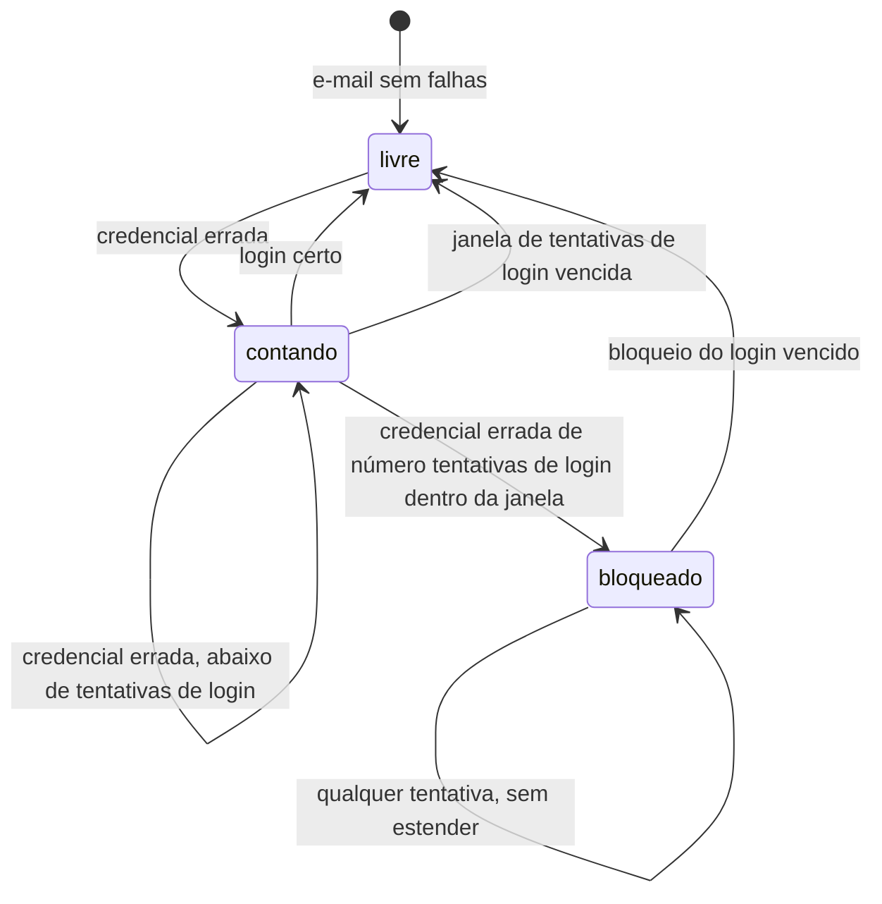

# LLD — Full Cycle Chat

2026-11-09 · Luiz Carlos · Status: rascunho · HLD: [hld.md](hld.md)

**Onde mora cada fato**

| Fato | Dono |
| --- | --- |
| Arquitetura, contêineres, integrações e motivos | [HLD](hld.md) |
| Decisões com porquê | `docs/adr/`, com o índice na seção "Decisões" deste documento e do HLD |
| Escopo e público | [Product brief](product-brief.md) |
| Vocabulário | `GLOSSARY.md` na raiz |
| Linguagem visual (cores, componentes, microtexto) | [Figma](https://www.figma.com/design/plW17JDOoRHydUJIIi2u87/slack) |
| Contrato REST da API do chat | `apps/chat-api/openapi.json`, gerado pelo `@nestjs/swagger` (planejado) |
| Contrato REST do Serviço de agentes | `apps/agents/openapi.json`, gerado pelo FastAPI (planejado) |
| Catálogo de códigos de erro | Os snapshots OpenAPI, como enum na resposta de erro de cada rota (planejado) |
| Eventos do WebSocket | Tipos TypeScript em `packages/chat-events/` (planejado) |
| Schema do Banco do chat | `apps/chat-api/migrations/`, migrações do TypeORM (planejado) |
| Schema do Banco dos agentes | A definir |
| Schema do Banco de negócio | Script de carga em `apps/agents/scripts/` (planejado) |
| Schema das variáveis de ambiente | O schema zod do módulo de configuração de cada projeto TypeScript (`apps/chat-api/src/config/env.schema.ts` existe; o da `web` é planejado); do projeto `agents`, a definir |
| Práticas e comandos | `apps/*/AGENTS.md`, um por app, apontados pelo `AGENTS.md` da raiz (planejado) |

Os snapshots OpenAPI ficam gravados no repositório, e a CI falha quando o código muda o contrato
sem atualizar o snapshot.

## 1. Estrutura do código

Um repositório com três aplicações implantadas separadamente (HLD, seção 5) e um pacote de tipos
compartilhado. `web`, `chat-api` e `chat-events` são projetos pnpm independentes, cada um com o
seu lockfile, sem workspace ([ADR 0017](adr/0017-projetos-pnpm-independentes.md)); `chat-events`
entra em `web` e em `chat-api` como dependência `file:../../packages/chat-events`, e uma mudança
nele exige reinstalar nos dois projetos. O projeto `agents` é gerenciado pelo uv.

```
apps/
  web/            Frontend/BFF (Next.js)                              existe
  chat-api/       API do chat (NestJS): REST, WebSocket e o comando   existe
                  de contas e permissões (HLD, seção 2)
    migrations/   migrações do Banco do chat                          existe
  agents/         Serviço de agentes e Worker (Python + ADK),         planejada
                  dois processos do mesmo projeto
    scripts/      script de carga do Banco de negócio                 planejada
packages/
  chat-events/    tipos dos eventos do WebSocket, usados por          planejada
                  chat-api e web
docs/             HLD, LLD, ADRs, brief
```

| Papel | Escolha | Por quê |
| --- | --- | --- |
| Frontend/BFF | Next.js com App Router | Next.js: HLD, seção 5 ([ADR 0002](adr/0002-next-bff-websocket-direto.md)); App Router: a definir |
| Mutações do navegador ao BFF | Server Actions | Checagem de `Origin` do próprio Next contra CSRF, formulário que funciona por teclado e nenhuma rota REST a manter para o navegador |
| Leituras no cliente que o tempo real altera | SWR | A definir |
| Tempo real, no servidor e no cliente | Socket.IO | [ADR 0019](adr/0019-socket-io-tempo-real.md) |
| API do chat | NestJS | HLD, seção 5 |
| ORM e migrações do Banco do chat | TypeORM | [ADR 0018](adr/0018-typeorm-api-do-chat.md) |
| Snapshot do contrato da API do chat | `@nestjs/swagger` | Gera o OpenAPI a partir do código |
| Hash de senha | Argon2id | Primeira recomendação da OWASP para senhas |
| Testes de ponta a ponta do `web` | Playwright, só no Chromium em modo headless, com `@axe-core/playwright` | Prova os fluxos pela tela, com a web e a API reais, e é o único seam da web; o produto é só para navegador de desktop. Sem teste de unidade na web por enquanto |
| Gerenciador dos projetos TypeScript | pnpm, um projeto por pasta, sem workspace | [ADR 0017](adr/0017-projetos-pnpm-independentes.md) |
| Agentes | Python + Google ADK | [ADR 0003](adr/0003-agentes-python-google-adk.md) |
| HTTP do Serviço de agentes | FastAPI próprio, com as rotas chamando o `Runner` do ADK | A definir |
| Gerenciador do projeto Python | uv | A definir |
| Fila de pedidos demorados | A definir | — |
| Acesso ao modelo, trocável por configuração (HLD, seção 2) | A definir | — |
| Geração do PDF | A definir | — |
| Acesso ao Banco dos agentes e migrações | A definir | — |
| Validação das variáveis de ambiente | zod, com `@nestjs/config` na API do chat; no projeto `agents`, a definir | Valida e tipa numa peça só, igual nos dois projetos TypeScript |
| Validação de entrada na API do chat | `class-validator` e `class-transformer`, no `ValidationPipe` do Nest | Caminho padrão do Nest, e o `@nestjs/swagger` lê os mesmos decorators para gerar o snapshot OpenAPI; descartado: zod com `nestjs-zod` |
| Parser da conferência de somente leitura | A definir | — |
| Log estruturado | A definir | — |

## 2. Componentes e dependências

Os tipos de peça de cada aplicação, o que cada tipo pode chamar e o diagrama das dependências
permitidas estão a definir, assim como os módulos de domínio da API do chat, do projeto `agents`
e do projeto `web`. O que já vale vem do HLD: o BFF dispara o agente
([ADR 0009](adr/0009-bff-dispara-agente.md)), o agente grava pela API do chat como bot
([ADR 0010](adr/0010-agente-grava-como-bot.md)) e o Worker nunca chama o modelo (HLD, seção 5).

### Integrações externas

Situação de todas: `planejada`.

**Armazenamento de objetos (S3)** — usado pelo Worker (gravar) e pela API do chat (URL).

| Operação | Recebe | Devolve | Garante |
| --- | --- | --- | --- |
| Gravar PDF | Chave e arquivo | Nada | Regravar a mesma chave substitui o arquivo; uma nova tentativa do Worker não duplica |
| Gerar URL de download | Chave e validade | URL assinada | Vencida a validade (`validade da URL do PDF`), a URL recusa |

**Fila de pedidos demorados** — o Serviço de agentes enfileira e o Worker consome.

| Operação | Recebe | Devolve | Garante |
| --- | --- | --- | --- |
| Enfileirar | Identificador de pedido e consulta já conferida | Nada | Enfileirar duas vezes o mesmo identificador gera um job só |
| Consumir | — | Um job ao Worker | Se o Worker falha, o job volta à fila até `tentativas do Worker` |

**Eventos por pessoa (Redis)** — usado pela API do chat para a reconexão (HLD 6.2).

| Operação | Recebe | Devolve | Garante |
| --- | --- | --- | --- |
| Guardar evento | Pessoa e evento | Identificador crescente por pessoa | A ordem dos identificadores é a ordem dos eventos daquela pessoa |
| Ler desde | Pessoa e último identificador confirmado | Os eventos seguintes, ou "perdido" | "Perdido" quando o identificador já saiu da `retenção dos eventos de reconexão`; o cliente então recarrega pelo histórico |

**Contadores (Redis)** — usados pelo Serviço de agentes (HLD 6.3).

| Operação | Recebe | Devolve | Garante |
| --- | --- | --- | --- |
| Conferir e contar pedido | Pessoa | Permitido ou negado | Nega acima do `limite de pedidos por pessoa` |
| Somar custo | Pedido e custo | Se o teto foi atingido | Compara com o `teto de custo por pedido` |

Com o Redis fora, as operações de contadores falham e o pedido é recusado (HLD, seção 8, "Erros,
novas tentativas e idempotência").

## 3. Conceitos transversais de implementação

### Segurança

- **Cookie de sessão:** gravado e apagado pelo BFF, com `HttpOnly`, `Secure`, `SameSite=Lax`,
  `Path=/` e `Max-Age` igual à `validade do cookie de sessão`. O `Domain` vem de variável e vale
  para os subdomínios (HLD 6.1). O cookie dura mais que a Sessão de propósito: quem decide se a
  Sessão vale é a API do chat ("Estados e regras", seção "Sessão e login"), e um cookie com Sessão
  vencida só leva a um 401. `Lax` não atrapalha o WebSocket, porque `app.` e `api.` são o mesmo
  site.
- **CSRF:** sem token anti-CSRF. As mutações do navegador são Server Actions, que conferem o
  cabeçalho `Origin`; o handshake do WebSocket confere a origem contra `WEB_ORIGIN`.
- **Identificador de sessão:** token aleatório de 32 bytes, entregue ao BFF uma vez, ao entrar.
  O Banco do chat guarda só o SHA-256 dele, então um vazamento do banco não dá Sessões válidas. O
  token nunca vai para o log.
- **Senha:** guardada como hash Argon2id. Quando o e-mail não tem conta, o login verifica a senha
  contra um hash fictício, para o tempo de resposta não revelar se a conta existe.
- **Limite de tentativas de login:** contado só pelo e-mail normalizado, inclusive de e-mails sem
  conta, e guardado no Banco do chat ([ADR 0023](adr/0023-limite-de-login-por-email.md)). As
  regras estão em "Estados e regras", seção "Sessão e login".
- **Participação em canal privado e conversa direta:** o lugar no código onde a API do chat a
  confere está a definir.
- **Credenciais de bot e de serviço:** a forma (um segredo por processo ou por agente) está a
  definir. Toda ação de bot leva o identificador de pedido
  ([ADR 0011](adr/0011-identificador-de-pedido.md)).
- **Dados de negócio no tempo real:** uma mensagem marcada "dados de negócio" é emitida pelo
  WebSocket pessoa a pessoa. Quem tem permissão de dados recebe o evento com o conteúdo; os outros
  membros recebem o evento com a versão bloqueada. O evento guardado nos eventos de reconexão
  segue a mesma regra, por pessoa. Mensagens sem a marca saem num evento só para a conversa
  ([ADR 0020](adr/0020-dados-de-negocio-pessoa-a-pessoa.md); depende de mudança no HLD). Se uma
  função única monta a mensagem para cada destinatário (histórico, REST, evento e notificação)
  está a definir.

### Concorrência e idempotência

- **Envio de mensagem:** unicidade em (autor, identificador gerado no cliente). A inserção tolera
  o conflito: se o identificador já existe, a API devolve a mensagem já gravada, com o mesmo
  status de sucesso, e não gera de novo menções, notificações, contadores nem eventos.
- **Ação de bot:** unicidade em (identificador de pedido, tipo de ação). Tipos: resposta, pergunta
  ao usuário, aviso de início, entrega do PDF, criação de tarefa. A repetição devolve o que já foi
  gravado, sem nova mensagem, tarefa ou notificação.
- **Contadores de não lidas e de menções:** um registro por pessoa e conversa, somado de forma
  atômica na transação da mensagem (incremento no próprio `UPDATE`, sem ler antes) e zerado quando
  a pessoa lê ([ADR 0021](adr/0021-contadores-gravados.md); depende de mudança no HLD).
- **Última leitura:** só avança. A atualização é condicional: grava só se a nova posição for
  posterior à gravada; uma posição igual ou anterior, vinda de uma aba atrasada, não muda nada e
  não altera os contadores.

### Transações

O que precisa ser atômico é do HLD (seção 7, "Regras que pesam no desenho"): a mensagem com as
menções, as notificações e os contadores; a tarefa com a notificação dela. O evento só sai depois
do commit. Onde a transação começa, como passa de um módulo a outro e como o evento é publicado
depois do commit (publicação direta ou tabela de saída) estão a definir.

### Erros

- Corpo de erro nas três APIs (BFF, API do chat, Serviço de agentes): `application/problem+json`
  (RFC 9457), com a extensão `code`, estável e em `snake_case`. O corpo tem `type`
  (`about:blank`), `title` (a frase do status HTTP), `status`, `detail` e `code`, sem `instance`.
  O `detail` é para pessoas e não traz detalhes internos.
- O catálogo de códigos fica nos snapshots OpenAPI, como enum na resposta de erro de cada rota.
- Na API do chat, o service e o guard lançam erro de domínio, e só o filter global o traduz em
  resposta HTTP: `.claude/rules/nest-api-errors.md`. No BFF e no Serviço de agentes, quem traduz
  está a definir.
- **Mensagem gravada, mas o Serviço de agentes não recebeu o pedido** (HLD 6.3): o BFF responde
  sucesso, com a mensagem gravada e um campo que diz que o agente não recebeu o pedido. A tela
  mostra a mensagem enviada e um aviso de erro do agente ao lado.

### Logs

A regra do HLD vale para todos os projetos: logs estruturados, sem conteúdo de mensagens e sem
resultado de consultas (HLD, seção 8, "Observabilidade"). A biblioteca, os campos de correlação e
a lista completa do que nunca vai para o log estão a definir.

| Nível | Quando |
| --- | --- |
| info | Fim de cada requisição e de cada pedido a agente, com tempo de resposta e custo como campos |
| warn | Resposta barrada pelo lastro; limite de pedidos ou teto de custo atingido; tentativa de login bloqueada |
| error | Falha do modelo; tentativas do Worker esgotadas; exceção inesperada |

### Configuração

- Cada projeto tem um módulo de configuração só, que lê e valida as variáveis uma vez na subida.
  Nenhum outro arquivo lê `process.env` ou `os.environ`; as peças recebem a configuração já
  tipada.
- Faltou uma variável obrigatória: o processo falha na subida, com o nome da variável na
  mensagem, e nunca no primeiro uso. Assim, a conferência de saúde da PaaS barra a versão nova e
  mantém a anterior (HLD, seção 9).
- Cada projeto tem um `.env.example` gravado no repositório, com todas as variáveis e valores
  falsos; o `.env` real fica no `.gitignore`.
- A biblioteca de validação está na seção "Estrutura do código"; a lista das variáveis fica em
  "Valores e configuração".

## 4. Dados

**Convenções** (tabelas nossas do Banco do chat e do Banco dos agentes; as tabelas de sessão do
ADK seguem o ADK):

- Nomes em `snake_case`, tabelas no plural (`messages`, `channel_members`); o TypeORM usa uma
  estratégia de nomes que converte os nomes do código.
- Id em UUID v7, gerado na aplicação ([ADR 0022](adr/0022-uuid-v7.md)).
- Datas em `timestamptz`, sempre em UTC, com `created_at` e `updated_at` em toda tabela. A
  conversão para o fuso de quem pediu acontece só na borda: na tela e no recorte "hoje" do agente.
- Exclusão física. A exceção é a mensagem: apagar zera o conteúdo e grava `deleted_at`, e a linha
  fica para mostrar "mensagem apagada" (HLD, seção 7).

O diagrama de entidades e relações está a definir. As unicidades e os contadores que as regras já
exigem estão em "Conceitos transversais de implementação", seção "Concorrência e idempotência".

| Banco | Entidade (HLD, seção 7) | Situação |
| --- | --- | --- |
| Chat | Pessoas (perfil, papel de administrador, permissão de dados) | a detalhar |
| Chat | Sessões | a detalhar |
| Chat | Canais e membros | a detalhar |
| Chat | Conversas diretas | a detalhar |
| Chat | Mensagens (autor pessoa ou bot, citação, marca "dados de negócio") | a detalhar |
| Chat | Menções | a detalhar |
| Chat | Última leitura e contadores por pessoa e conversa | a detalhar |
| Chat | Notificações | a detalhar |
| Chat | Tarefas | a detalhar |
| Chat | Pedidos aos agentes e ações de bot | a detalhar |
| Chat | Perguntas pendentes | a detalhar |
| Chat | Referência ao PDF de uma mensagem | a detalhar |
| Agentes | Registro de agentes conectados | a detalhar |
| Agentes | Sessões do ADK | criadas pelo ADK |
| Negócio | Dados de vendas | dono: script de carga |

## 5. Interfaces

**Convenções**

- Prefixo `/v1` na API do chat e no Serviço de agentes; `/api`, sem versão, no BFF, porque o
  Frontend e o BFF são implantados juntos. Uma mudança que quebra entre serviços sai como nova
  versão do prefixo, em duas implantações.
- Autenticação: o navegador fala com o BFF por cookie de sessão; o BFF leva a sessão à API do chat
  repassando o mesmo cookie no cabeçalho `Cookie`, então a API do chat tem um caminho de
  autenticação só, igual no REST e no WebSocket; o BFF chama o Serviço de agentes com a credencial de serviço; os bots chamam a
  API do chat com a credencial de bot e o identificador de pedido (forma em "Segurança").
- Campos do JSON em `snake_case`, nas três APIs.
- Paginação: a definir.
- Erros: "Conceitos transversais de implementação", seção "Erros".
- Eventos do WebSocket: tipos em `packages/chat-events/`, consumidos por `chat-api` e `web`.

**Índice das rotas**

O índice por domínio (BFF; API do chat, para o BFF e para os bots; Serviço de agentes) e a lista
de eventos do WebSocket estão a definir. As rotas já decididas:

| Método e caminho | Situação | Comportamento |
| --- | --- | --- |
| API do chat: `POST /v1/sessions` | planejada | Entrar: "Estados e regras", seção "Sessão e login" |
| API do chat: `GET /v1/sessions/current` | planejada | Verificar e renovar a Sessão: mesma seção |
| API do chat: `DELETE /v1/sessions/current` | planejada | Sair: mesma seção |
| BFF: Server Actions entrar e sair | planejada | Gravam e apagam o cookie: "Conceitos transversais de implementação", seção "Segurança" |
| Envio de mensagem no BFF (Server Action) | a detalhar | Mensagem gravada e agente sem receber o pedido: "Conceitos transversais de implementação", seção "Erros" |

## 6. Estados e regras

As subseções desta parte (pedido ao agente, pergunta pendente, mensagem, consulta a dados de
negócio, limite de pedidos e teto de custo) e as regras de cada uma estão a definir. As regras já
decididas ficam abaixo.

### 6.1 Tarefa

Dois estados: aberta e concluída (HLD 6.6).

- Só o responsável conclui e reabre a tarefa. Outra pessoa, inclusive quem delegou, recebe um
  erro do catálogo.
- Ao concluir ou reabrir, quem delegou é avisado (HLD 6.6).
- Concluir uma tarefa já concluída, ou reabrir uma aberta: a definir.

### 6.2 Sessão e login

Situação: `planejada`. Rotas em "Interfaces"; cookie, token e senha em "Conceitos transversais
de implementação", seção "Segurança".

**Entrar**

- O e-mail é normalizado antes de tudo: sem os espaços das pontas e em minúsculas. É assim que
  ele é gravado, comparado e contado no limite.
- E-mail sem conta e senha errada recebem a mesma resposta, `invalid_credentials`, com o mesmo
  corpo.
- Com a credencial certa e o e-mail fora do bloqueio, a API cria uma Sessão com `expires_at` =
  agora + `duração da Sessão` e devolve o token.

**Verificar**

- Token desconhecido, Sessão vencida ou cookie ausente recebem `unauthenticated`, sem distinguir
  os casos. A Sessão vencida é apagada nessa hora.
- Uma Sessão válida é renovada (`expires_at` = agora + `duração da Sessão`) só quando passou o
  `intervalo de renovação da Sessão` desde o `last_used_at`. Assim, quem usa o chat ao menos uma
  vez dentro da `duração da Sessão` não precisa entrar de novo, e o banco recebe no máximo uma
  escrita por Sessão a cada intervalo.

**Sair e revogar**

- Sair apaga a Sessão apresentada. As outras Sessões da mesma Pessoa continuam valendo.
- Revogar é apagar a linha, pelo comando de contas; a próxima requisição com aquela Sessão recebe
  `unauthenticated`. Redefinir a senha revoga todas as Sessões da Pessoa.

**Limite de tentativas** ([ADR 0023](adr/0023-limite-de-login-por-email.md))

**Estados do limite de um e-mail**



Legenda: "livre" é o e-mail sem linha de tentativas; o estado vale por e-mail normalizado.

- Só conta a tentativa com entrada válida e credencial errada. Um erro de validação não conta.
- A janela começa na primeira falha. Uma falha depois de vencida a `janela de tentativas de
  login` recomeça a contagem em 1.
- A falha de número `tentativas de login` dentro da janela bloqueia o e-mail por `bloqueio do
  login`.
- Durante o bloqueio, toda tentativa recebe `too_many_login_attempts`, mesmo com a senha certa,
  com o tempo que falta no `Retry-After`. Essas tentativas não contam nem estendem o bloqueio, e
  cada uma gera um log `warn`.
- Um login certo fora do bloqueio apaga a contagem.
- O incremento é atômico, no próprio `UPDATE` do upsert, para duas falhas simultâneas contarem as
  duas.
- A resposta é a mesma para e-mail com e sem conta, para não revelar se o e-mail tem conta.

## 7. Processos de segundo plano

| Job | Disparo | O que faz | Na falha | Situação |
| --- | --- | --- | --- | --- |
| Relatório em PDF (Worker) | Pedido na fila (HLD 6.5) | HLD 6.5 | Nova tentativa até `tentativas do Worker`; esgotadas, grava "não consegui" (HLD 6.5) | a detalhar |

A idempotência do job (chave no S3 e entrega única) e outras rotinas (retenção dos PDFs,
perguntas pendentes vencidas) estão a definir. Sessões vencidas não têm rotina: são apagadas
quando apresentadas ("Estados e regras", seção "Sessão e login") e pela operação
`purge-expired-sessions` do comando de contas.

## 8. Cliente

**Telas**

| Rota | Acesso | Lê | Ações | Situação |
| --- | --- | --- | --- | --- |
| `/entrar` | Público | Sessão, quando há cookie | Entrar com e-mail e senha | planejada |
| `/` (Home) | Sessão | Pessoa da Sessão | Sair | planejada |
| A definir | Sessão | Histórico da conversa | Enviar, editar, apagar, citar; "digitando"; botões de resposta pronta | a detalhar |
| A definir (lateral) | Sessão | Conversas, com não lidas e menções | Abrir conversa | a detalhar |
| A definir | Sessão | Atividade: Menções, DMs, Tarefas | Abrir a mensagem; concluir e reabrir tarefa | a detalhar |
| A definir | Sessão | Perfil próprio e de outras pessoas | Editar o próprio perfil e a presença | a detalhar |
| A definir | Sessão | Busca de pessoas | Abrir conversa direta | a detalhar |
| A definir | Sessão | — | Criar canal; convidar para canal privado | a detalhar |
| A definir | Sessão; conectar e desconectar só para administrador | Agentes e estado de conexão | Conectar e desconectar agente | a detalhar |

**Leituras e tempo real.** A página carrega pelos Server Components. No cliente, o SWR guarda as
leituras que o tempo real altera (mensagens, não lidas, notificações), e cada evento do WebSocket
atualiza esse cache direto, sem nova requisição.

**Sessão no cliente.**

- O proxy do Next confere só se o cookie de sessão existe; sem ele, manda para "Entrar". A
  validação de verdade é da API do chat.
- O layout das telas logadas verifica a Sessão na API do chat a cada renderização:
  - Com 401, apaga o cookie e manda para "Entrar".
  - Com falha de rede, 5xx ou tempo esgotado, mostra "Não foi possível verificar sua sessão",
    com "Tentar de novo", e não manda para "Entrar".
- "Entrar", aberta com cookie, faz a mesma verificação:
  - Com 200, vai para a Home.
  - Com 401, apaga o cookie e mostra o formulário.
- Qualquer 401 vindo do BFF manda para "Entrar".
- Um 401 no WebSocket fecha a conexão e manda para "Entrar".
- **Voltar para onde ia:** quem é mandado para "Entrar" leva o caminho pedido em `?para=`.
  - Só vale um caminho relativo que começa com `/` e não com `//`.
  - Sem ele, ou com outro valor, a Pessoa vai para a Home depois de entrar.
- **Histórico depois de sair:**
  - As telas logadas saem com `Cache-Control: no-store`.
  - O layout logado recarrega a página no evento `pageshow` com `persisted`.
  - Assim, nem o cache nem o bfcache mostram conteúdo a quem saiu.

**Notificação do navegador.**

- A permissão do navegador é pedida só quando a pessoa liga a opção (brief, item 6 do escopo).
- A notificação sai do evento do WebSocket, com o chat aberto em alguma aba (HLD, seção 4).
- O clique abre a conversa posicionada na mensagem.

**Reação a erros da API.** 401: "Sessão no cliente". Mensagem gravada com erro do agente:
"Conceitos transversais de implementação", seção "Erros".

## 9. Valores e configuração

**Valores de regra**

| Nome | Valor | Onde vale | Constante ou variável |
| --- | --- | --- | --- |
| Limite de pedidos por pessoa | 10 por minuto (brief, RNF "Custo") | Serviço de agentes | A definir |
| Teto de custo por pedido | A definir | Serviço de agentes | A definir |
| Tentativas do Worker | A definir | Worker | A definir |
| Validade da URL do PDF | A definir | API do chat | A definir |
| Duração da Sessão | 30 dias sem uso (PRD da F01, história 3) | API do chat | Variável `SESSION_TTL_DAYS`, padrão 30 |
| Intervalo de renovação da Sessão | 1 dia | API do chat | Constante |
| Validade do cookie de sessão | 400 dias, o teto do Chrome | BFF | Constante |
| Tentativas de login | 5 (PRD da F01, história 2) | API do chat | Constante |
| Janela de tentativas de login | 15 min (PRD da F01, história 2) | API do chat | Constante |
| Bloqueio do login | 15 min (PRD da F01, história 2) | API do chat | Constante |
| Validade do identificador de pedido | A definir | API do chat | A definir |
| Retenção dos eventos de reconexão | A definir | API do chat (Redis) | A definir |
| Tempo limite da consulta ao Banco de negócio | A definir | Serviço de agentes e Worker | A definir |
| Tamanho da página do histórico | A definir | API do chat | A definir |

**Variáveis de ambiente**

O que cada contêiner recebe está no HLD, seção 8, "Configuração e segredos". As já decididas
(`DATABASE_URL` e `PORT` da API do chat já existem; as demais são `planejadas`):

| Projeto | Variável | Para quê |
| --- | --- | --- |
| API do chat | `DATABASE_URL` | Conexão com o Banco do chat |
| API do chat | `WEB_ORIGIN` | Origem aceita no handshake do WebSocket |
| API do chat | `SESSION_TTL_DAYS` | `Duração da Sessão` |
| API do chat | `PORT` | Porta HTTP em que a API escuta |
| Web | `CHAT_API_URL` | Endereço interno da API do chat |
| Web | `SESSION_COOKIE_NAME` | Nome do cookie de sessão |
| Web | `SESSION_COOKIE_DOMAIN` | `Domain` do cookie; vazio no local |
| Web | `SESSION_COOKIE_SECURE` | `Secure` do cookie; `false` no local |

As demais variáveis estão a definir.

## 10. Ambiente de desenvolvimento

Tudo roda em contêineres, pelo `compose.yaml` da raiz (projeto `fullcycle-slack-ia`). O que
substitui cada serviço de produção segue o HLD, seção 9, "Implantação e ambientes".

| Serviço | Imagem | Porta no host | Papel |
| --- | --- | --- | --- |
| `web` | `apps/web/Dockerfile.dev` (Node 26, pnpm 11) | 3000 | Frontend/BFF |
| `chat-api` | `apps/chat-api/Dockerfile.dev` (Node 26, pnpm 11) | 3001 (3000 no contêiner) | API do chat |
| `postgres` | `postgres:18` | 5432 | Banco do chat, dos agentes e de negócio |
| `s3` | `chrislusf/seaweedfs:4.52` (`weed mini`) | 8333 | Substituto do armazenamento compatível com S3, com o bucket `reports` |
| `e2e` (planejado) | Imagem oficial do Playwright, na mesma versão do `@playwright/test` do `web` | — | Roda os testes de ponta a ponta do `web` contra `http://web:3000` e o `playwright-cli`; sobe só pelo `profile` e fica parado, como `web` e `chat-api` |

Entram depois: o Redis, quando o primeiro uso dele for implementado, e os serviços `agents` e
`worker`, quando `apps/agents` existir.

**Contêineres dos apps**

- A imagem não tem dependências. O `CMD` roda `pnpm install --frozen-lockfile` e mantém o
  contêiner de pé; o app sobe na mão: `docker compose exec chat-api pnpm start:dev` e
  `docker compose exec web pnpm dev`. Se o install falha, o contêiner continua de pé e o erro
  fica em `docker compose logs`.
- O repositório inteiro é montado em `/home/node/app`, para o `file:../../packages/chat-events`
  resolver igual dentro e fora. O `node_modules` fica no disco do host, visível para o editor.
- Os contêineres rodam como `node` (uid 1000), o mesmo usuário do host no WSL.
- O store do pnpm fica em `.pnpm-store/` na raiz, ignorado pelo git e compartilhado pelos dois
  apps. A versão do pnpm é a do `packageManager` de cada projeto, igual nos dois.
- Bindings nativos são compilados no contêiner: o Node do host precisa ser o mesmo major (26)
  para rodar ferramentas pelo host sobre o mesmo `node_modules`.

**Postgres.** O script `docker/postgres/init/01-create-databases.sh` roda só com o volume vazio
e cria os bancos `chat`, `agents` e `business`, cada um com um usuário dono de mesmo nome, e o
usuário `business_readonly`, que só conecta no `business` e só lê, inclusive as tabelas que o
script de carga criar depois ([ADR 0013](adr/0013-somente-leitura-banco-e-codigo.md)). Nenhum
usuário conecta num banco que não é o seu. Senhas iguais ao nome do usuário, só locais.

**Diferenças do ambiente local que mudam o código**

- **Cookie de sessão:** localmente é só de host, em `localhost`, sem o atributo `Domain`; os
  cookies não separam portas, então `web` e `chat-api` o recebem. Em produção vale para os
  subdomínios (HLD 6.1).
- **Endereço da API do chat:** o BFF a chama pela rede interna (`http://chat-api:3000`); o
  navegador abre o WebSocket em `localhost:3001`. São dois endereços configurados.
- **Endereço do S3:** a API do chat assina a URL do PDF com o endereço que o navegador alcança
  (`http://localhost:8333`), porque a assinatura inclui o host; o Worker grava pelo endereço
  interno (`http://s3:8333`). São dois endereços configurados, com acesso por caminho
  (path-style).
- **Banco dos testes da API do chat:** `chat_test`, do mesmo dono que o `chat`, para os testes
  não misturarem dados com o desenvolvimento. Ele é criado pelo script de inicialização do
  Postgres e, num volume que já existe, pelo `globalSetup` dos testes, que conecta como o
  superusuário local para criar o banco, porque o papel `chat` não tem `CREATEDB`, e também roda
  as migrações.
- **Contêiner `e2e`:** fica de pé porque o fluxo da skill `playwright-cli` pausa o teste em
  segundo plano (`--debug=cli`) e conecta o `playwright-cli` a ele, e os dois precisam estar no
  mesmo contêiner. O `playwright-cli` é o do `@playwright/test` instalado no `web`, sem instalação
  global, e o relatório HTML não abre sozinho (`PLAYWRIGHT_HTML_OPEN=never` no ambiente do
  serviço).
- **Dados dos testes da web:** o Playwright roda contra o ambiente de desenvolvimento, no banco
  `chat`. Cada teste cria a própria Pessoa, com e-mail de prefixo `e2e-` no domínio `teste.local`,
  e as Pessoas de teste ficam no banco até serem apagadas pelo prefixo ou por um `down -v`.
- Os nomes das variáveis estão em "Valores e configuração".
- O local não reproduz a rede privada nem a volta automática da PaaS (HLD, seção 9).

## 11. Decisões

| ADR | Decisão | Status |
| --- | --- | --- |
| [0017](adr/0017-projetos-pnpm-independentes.md) | Três projetos pnpm independentes, sem workspace | aceita |
| [0018](adr/0018-typeorm-api-do-chat.md) | TypeORM na API do chat | aceita |
| [0019](adr/0019-socket-io-tempo-real.md) | Socket.IO no tempo real | aceita |
| [0020](adr/0020-dados-de-negocio-pessoa-a-pessoa.md) | Mensagem de dados de negócio emitida pessoa a pessoa no WebSocket | aceita |
| [0021](adr/0021-contadores-gravados.md) | Contadores de não lidas e de menções gravados na transação | aceita |
| [0022](adr/0022-uuid-v7.md) | UUID v7 como id, gerado na aplicação | aceita |
| [0023](adr/0023-limite-de-login-por-email.md) | Limite de tentativas de login contado só pelo e-mail | aceita |

As decisões que mudam o desenho estão no HLD, seção 10.

## 12. Questões em aberto

**Estrutura e bibliotecas**

- [ ] Biblioteca da fila no Redis (arq, Celery ou RQ).
- [ ] Acesso ao modelo: `LiteLlm` do ADK para os três provedores, ou Gemini nativo e `LiteLlm`
      para OpenAI e Anthropic.
- [ ] Biblioteca do PDF (WeasyPrint, ReportLab ou fpdf2).
- [ ] Acesso ao Banco dos agentes e migrações (SQLAlchemy com Alembic, ou SQL cru); com ela, o
      dono do schema desse banco.
- [x] Biblioteca de validação das variáveis nos projetos TypeScript: zod. No projeto `agents`,
      segue em aberto.
- [ ] Parser da conferência de somente leitura (pglast ou sqlglot).
- [ ] Biblioteca de log estruturado (pino e structlog, ou o logger de cada framework).
- [ ] Porquê das escolhas sem motivo registrado: App Router, SWR, FastAPI próprio, uv; ADRs 0017,
      0018, 0019, 0021 e 0022.

**Componentes**

- [ ] Tipos de peça e dependências permitidas na API do chat, no Serviço de agentes e no Worker, e
      no `web`, com o diagrama.
- [ ] Módulos de domínio dos três projetos.
- [x] Como o navegador chama o BFF nas mutações: Server Actions.

**Conceitos transversais**

- [x] `SameSite` do cookie e defesa contra CSRF.
- [x] Formato do identificador de sessão e forma de guardá-lo.
- [ ] Credenciais de bot (por processo ou por agente) e credencial de serviço.
- [x] Chave do limite de tentativas de login: só o e-mail (ADR 0023).
- [x] Origem do IP atrás do proxy: deixou de ser necessária, porque o limite não usa o IP.
- [ ] Lugar da conferência de participação em canal privado e conversa direta.
- [ ] Função única que monta a mensagem para cada destinatário.
- [ ] Onde a transação começa e como passa entre módulos.
- [ ] Publicação do evento depois do commit: direta ou por tabela de saída.
- [x] Quem traduz exceção em resposta na API do chat: o filter global.
- [ ] Quem traduz exceção em resposta no BFF e no Serviço de agentes.
- [ ] Campos de correlação dos logs.
- [ ] O que nunca vai para o log, além do que o HLD já diz.
- [ ] Contadores quando a leitura avança até uma mensagem que não é a última da conversa.

**Dados e interfaces**

- [ ] Canais e conversas diretas: uma tabela com tipo, ou tabelas separadas.
- [ ] Bots na mesma tabela das pessoas, ou não.
- [ ] Diagrama de entidades e relações; forma das tabelas.
- [ ] Paginação do histórico e das listas.
- [x] Como o BFF leva a sessão à API do chat.
- [ ] Índice das rotas (BFF, API do chat para o BFF e para os bots, Serviço de agentes) e lista
      de eventos do WebSocket.

**Estados, regras e processos**

- [ ] Subseções de "Estados e regras": pedido ao agente (estados; resposta a uma pergunta como
      pedido novo ou continuação), pergunta pendente (quando termina), mensagem (exclusão com
      menções, notificações e contadores; edição que acrescenta menção), consulta
      a dados de negócio (comparação do lastro), limite de pedidos e teto de custo, presença e
      "digitando".
- [ ] Tarefa: concluir uma já concluída, ou reabrir uma aberta.
- [ ] Idempotência do job do PDF (chave no S3, entrega única) e outras rotinas (retenção dos
      PDFs, perguntas pendentes vencidas).

**Valores, configuração e ambiente**

- [ ] Valores de regra marcados "A definir" em "Valores e configuração", e se o limite de pedidos
      é constante ou variável.
- [ ] Nomes, projetos e origem das demais variáveis de ambiente (as da sessão estão decididas).
- [x] Diferenças do ambiente local que mudam o código ou os testes (seção 10).
