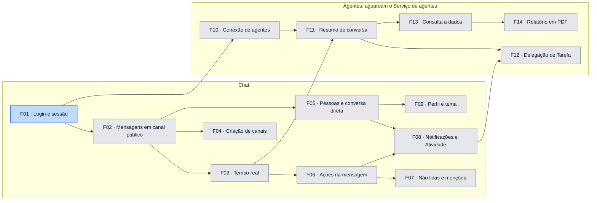

# Roadmap — Full Cycle Chat

2026-11-09 · Luiz Carlos

As funcionalidades a desenvolver, a ordem entre elas e o status de cada uma. O objetivo de cada
fase e o critério para passar de uma a outra estão no [product brief](product-brief.md), seção
"Roadmap". O que é uma funcionalidade, a pasta dela e quando cada status muda estão no
[`AGENTS.md`](../AGENTS.md), seção "Planejamento".

**Status:** planejada → PRD pronto → spec pronta → em andamento → concluída.

O ID vira link para a pasta da funcionalidade, em `docs/funcionalidades/`, quando ela é criada.

## Fase 1: fechar o MVP

### Chat

| ID | Funcionalidade | Ao final a pessoa consegue | Depende de | Status |
| --- | --- | --- | --- | --- |
| [F01](funcionalidades/01-login-e-sessao/) | Login e sessão | Entrar com e-mail e senha numa conta criada pela empresa, continuar logada em todas as abas do navegador e sair. | — | em andamento |
| F02 | Mensagens em canal público | Abrir um canal público, enviar mensagens e rolar o histórico até as mais antigas. | F01 | planejada |
| F03 | Tempo real | Ver as mensagens dos outros chegarem sem recarregar a página, ver quem está digitando e não perder nada depois de uma queda de conexão. | F02 | planejada |
| F04 | Criação de canais e convite para canal privado | Criar um canal público ou privado e convidar pessoas para o privado, que só os convidados veem. | F02 | planejada |
| F05 | Busca de pessoas, perfil e conversa direta | Buscar uma pessoa por nome ou @usuário, ver o perfil dela e conversar com ela numa conversa direta. | F02 | planejada |
| F06 | Ações na mensagem | Mencionar pessoas, responder citando uma mensagem, copiar o texto e editar ou apagar as próprias mensagens, com a mudança aparecendo para todos na hora. | F03 | planejada |
| F07 | Não lidas e menções | Ver, em cada canal e conversa, quantas mensagens não lidas e quantas menções há. | F06 | planejada |
| F08 | Notificações e Atividade | Receber um alerta na tela e, se ligar, uma notificação do navegador ao ser mencionada ou receber uma DM, clicar e cair na mensagem, e rever tudo em Atividade → Menções e DMs. | F05, F06 | planejada |
| F09 | Perfil e tema | Editar nome, cargo, telefone, status e presença, e trocar entre o tema claro e o escuro. | F05 | planejada |

### Agentes: aguardam o Serviço de agentes

Por enquanto a aplicação de agentes não será desenvolvida, e estas funcionalidades dependem dela:
o registro de agentes conectados e a execução dos pedidos ficam no Serviço de agentes (HLD, seção
"Arquitetura"). O que vem depois da F09 está a definir.

| ID | Funcionalidade | Ao final a pessoa consegue | Depende de | Status |
| --- | --- | --- | --- | --- |
| F10 | Conexão de agentes | Como administrador, conectar e desconectar um agente do workspace. Quem não administra vê os agentes e a quem pedir. | F01 | planejada |
| F11 | Resumo de conversa pelo agente | Mencionar o agente e receber na conversa um resumo com recorte (hoje, desde ontem, a semana, tudo, por pessoa, por assunto). Sem recorte, escolher por um botão ou responder sem mencionar o agente de novo. | F03, F10 | planejada |
| F12 | Delegação de Tarefa pelo agente | Pedir ao agente que delegue uma Tarefa a alguém mencionado. Quem recebe é notificado, vê a Tarefa em Atividade → Tarefas e a conclui ou reabre, e quem delegou é avisado. | F08, F11 | planejada |
| F13 | Consulta a dados de negócio | Perguntar sobre os números do negócio em linguagem natural e receber a resposta em texto na conversa, que fica bloqueada para quem não tem permissão de dados. | F11 | planejada |
| F14 | Relatório em PDF | Pedir um relatório em PDF, seguir conversando enquanto ele é gerado e baixá-lo na conversa quando ficar pronto, desde que tenha permissão. | F13 | planejada |

### Mapa de pendências

**Dependências da Fase 1**

A seta vai da funcionalidade que precisa estar concluída para a que depende dela. A cor é o
status: cinza, planejada; azul-claro, PRD pronto; azul, spec pronta; amarelo, em andamento;
verde, concluída.

## Fase 2: operar como produto

Sem dependências definidas por enquanto.

| ID | Funcionalidade | Ao final a pessoa consegue | Status |
| --- | --- | --- | --- |
| F15 | Cadastro e convite de pessoas | Como administrador, convidar uma pessoa por e-mail, e a pessoa convidada criar a própria conta e entrar no workspace. | planejada |
| F16 | Papéis e permissões | Como administrador, dar e tirar o papel de administrador e a permissão de dados de cada pessoa por uma tela, sem script. | planejada |
| F17 | Remoção de membros de canal privado | Remover uma pessoa de um canal privado, que deixa de vê-lo. | planejada |
| F18 | Entrar e sair de canais | Entrar num canal e sair de um canal de que participa. | planejada |
| F19 | Busca de mensagens | Buscar mensagens por texto nas conversas a que tem acesso. | planejada |
| F20 | Threads | Responder a uma mensagem numa thread, sem misturar a resposta à conversa principal. | planejada |
| F21 | Reações | Reagir a uma mensagem com um emoji e ver as reações dos outros. | planejada |
| F22 | Anexos de arquivo | Anexar um arquivo a uma mensagem e baixar os arquivos que os outros anexaram. | planejada |
